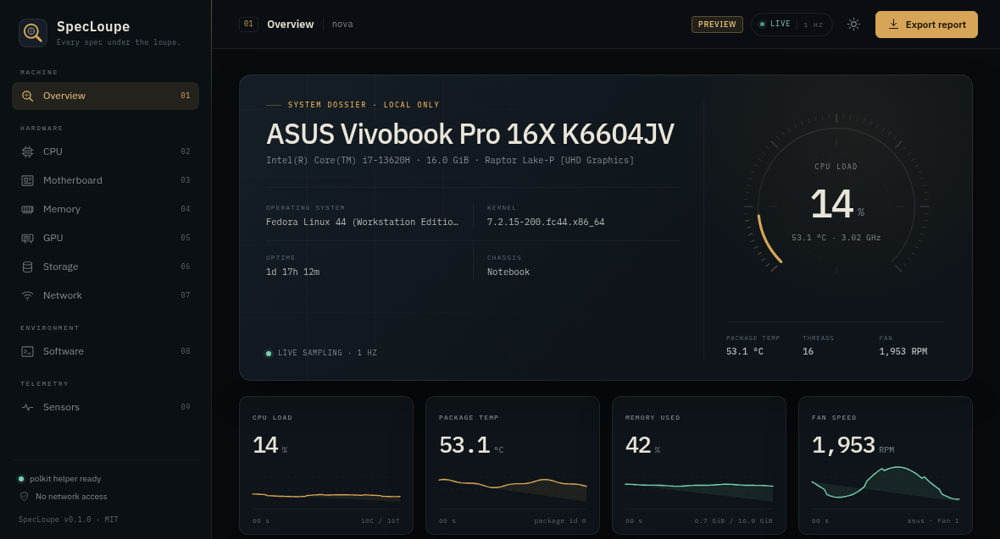

<div align="center">
  
  <h1>SpecLoupe</h1>
  <p><strong>Every spec under the loupe.</strong></p>
  <p>A local-first hardware and system inspector for Linux —<br />dense technical readouts, live sensors and reports that respect your privacy.</p>
  <p>
    
    
  </p>
</div>



<p align="center"><em>Interface preview with sample data.</em></p>

SpecLoupe reads what your machine already exposes through `/proc`, `/sys`, DMI and device tools, then presents it as a precise instrument panel — not a dashboard of vague cards. It is built with Tauri 2, Rust and React, and keeps everything on your computer.

## What it shows

| Page | Contents |
| --- | --- |
| **Overview** | Host identity, OS, kernel, uptime, live CPU load, memory pressure, interfaces and quick facts |
| **CPU** | Model, topology, cache, flags, vulnerabilities, per-core clocks and governor |
| **Motherboard** | SMBIOS BIOS, system, board and chassis records, plus SMBIOS processor inventory |
| **Memory** | Physical totals, swap, DIMM slots, part numbers, ranks and configured speeds |
| **GPU** | Render devices, PCIe link, driver, VRAM, OpenGL/Vulkan and display connectors with EDID names |
| **Storage** | Physical disks, partitions, filesystems, mount points and SMART health |
| **Network** | Interfaces, MAC addresses, IPv4/IPv6, link speed, MTU and wireless/wired state |
| **Software** | Distribution, kernel command line, glibc, systemd, secure boot, package inventory and virtualization |
| **Sensors** | Live temperatures, fan RPM, battery, package power and per-core clocks with 60-second sparklines |

Use the **Export** button to save a Markdown or JSON report. Serial numbers, MAC addresses, IP addresses, asset tags and UUIDs are omitted by default; you have to opt in to include them.

## Live sensors

- Samples hardware state once per second.
- Keeps a 60-second rolling history for sparklines.
- Pauses automatically while the window is unfocused, then resumes without a burst of stale data.
- Uses `coretemp`/`k10temp` for package temperature, hwmon for fans and disks, `powercap` for package power, and vendor tools when present.
- Shows “locked” instead of inventing a value when a sensor needs privileges the app does not have.

## Privileged data, without running as root

Some values are only readable by root: DMI serial numbers, asset tags and full SMART health. SpecLoupe asks for that access once at startup, as soon as the machine has been identified, through `pkexec`:

- The app executes a fixed, read-only Bash helper via PolicyKit.
- The helper runs `dmidecode` for DMI types 0, 1, 2, 3, 4 and 17, and `smartctl -j -a` for detected physical disks.
- Device paths are validated before they are passed to the helper.
- No persistent root daemon, setuid binary or password is stored.
- Dismissing the PolicyKit prompt simply leaves the privileged panels empty; you can retry from Motherboard, Memory or Storage.

SpecLoupe never escalates itself to root. If it is launched as root, the helper runs directly.

## Privacy

- **No telemetry, analytics or network calls.** All collectors are local.
- **No cloud account or sync.**
- Reports are written only to the location you choose.
- Sensitive fields are redacted in exports by default.

## Requirements

### Runtime

SpecLoupe degrades gracefully when optional tools are missing, but these provide the fullest picture:

| Purpose | Package | Command |
| --- | --- | --- |
| Block devices, partitions | `util-linux` | `lsblk` |
| Network interfaces | `iproute` | `ip` |
| PCI inventory | `pciutils` | `lspci` |
| DMI/SMBIOS | `dmidecode` | `dmidecode` |
| SMART health | `smartmontools` | `smartctl` |
| PolicyKit prompt | `polkit` | `pkexec` |
| OpenGL renderer | `mesa-demos` | `glxinfo` |
| Vulkan summary | `vulkan-tools` | `vulkaninfo` |
| Fan/lm-sensors state | `lm_sensors` | `sensors` |
| NVIDIA telemetry | NVIDIA driver | `nvidia-smi` |

On Fedora:

```bash
sudo dnf install dmidecode smartmontools pciutils mesa-demos vulkan-tools lm_sensors
```

### Build

- Node.js 20.19+ or 22.12+
- Rust 1.85+ (install with [rustup](https://rustup.rs))
- Tauri 2 Linux dependencies

On Fedora:

```bash
sudo dnf install gtk3-devel webkit2gtk4.1-devel librsvg2-devel libappindicator-gtk3-devel openssl-devel
sudo dnf group install "C Development Tools and Libraries"
```

On Debian/Ubuntu, install the equivalent Tauri 2 packages:

```bash
sudo apt install libwebkit2gtk-4.1-dev build-essential curl wget file libxdo-dev \
  libssl-dev libayatana-appindicator3-dev librsvg2-dev
```

## Build and run

```bash
git clone https://github.com/aluisiolucio/specloupe-app.git
cd specloupe-app

npm install
npm run tauri dev
```

Production build:

```bash
npm run tauri build
```

The binary is named `specloupe`; the package and repository are named `specloupe-app`. Tauri app identifier: `io.github.aluisiolucio.SpecLoupe`.

### Browser preview

The frontend also runs without the Rust backend:

```bash
npm run dev
```

Without Tauri, SpecLoupe automatically switches to a clearly labeled **Preview** mode with fictional demo data so the interface can be explored safely.

## How it is organized

```text
src/                     React + TypeScript interface
  pages/                 One component per tab
  components/            Shared cards, gauges, sparklines, spec rows, dialogs
  hooks/                 Data loading, live sampling, privileged data
  lib/                   API bridge, formatting, demo data, report builder
  styles/                Design tokens and the full visual system
src-tauri/src/
  collectors/            Platform collectors for CPU, board, memory, GPU, storage, network, software, sensors
  commands.rs            Tauri commands, caching, live pause flag, report writing
  privileged.rs          Fixed pkexec helper and DMI/SMART parsers
  models.rs              Serializable data model shared with the frontend
```

Collectors prefer kernel interfaces and JSON output. Parsers are defensive: missing fields become `null`, and the UI renders a dash instead of guessing.

## Known limitations

- Hardware coverage depends on drivers and firmware. Some laptops expose no GPU temperature, no fan RPM, or no battery energy counters.
- Some firmware reports raw or implausible fan values. SpecLoupe shows what hwmon provides rather than guessing at a conversion.
- Intel RAPL energy counters are often root-only; SpecLoupe reports package power as locked rather than prompting for a password just to sample it.
- SMART data requires `smartctl`; NVMe and ATA attributes differ, so not every drive reports every metric.
- Virtual machines expose synthetic hardware, so some fields will be absent or generic.
- The interface is English-only today.

## License

MIT © 2026 [Aluisio Lucio](https://github.com/aluisiolucio)
